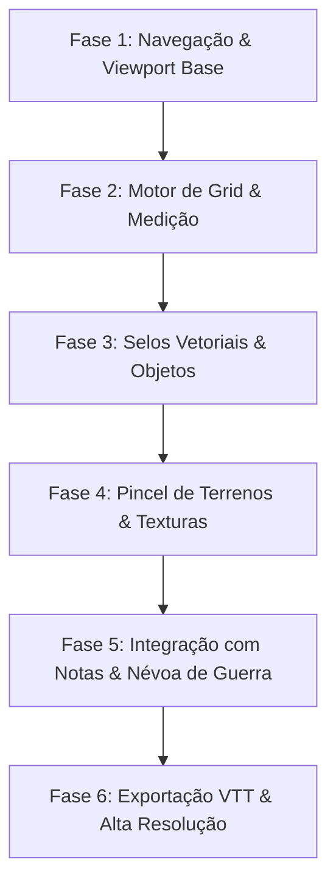

# 🗺️ FEATS 2 — Módulo "World & Battlemap Forge" (Estilo Inkarnate)
> **RollDeck V3 Cartography & Tactical Battlemap Studio**  
> Criação, pintura e exportação de mapas mundiais, regionais e battlemaps táticos de combate integrados diretamente às notas wiki, ao gerador de loot e à mesa de dados.

---

## 📋 1. Visão Geral do Recurso

O **World & Battlemap Forge** expandirá o RollDeck V3 de um rolador e mapa mental para um **estúdio completo de cartografia de mesa** (semelhante ao Inkarnate e DungeonDraft).

### 🌟 Diferencial Competitivo em Relação ao Inkarnate:
O Inkarnate é uma ferramenta gráfica isolada. No RollDeck V3, o criador de mapas está **nativamente interligado com as regras do jogo**:
1. **Nós de Lore Integrados**: Uma sala de masmorra ou cidade desenhada no mapa possui uma nota wiki associada (`[[Taverna do Javali]]`).
2. **Interação com Loot**: Ao posicionar ou inspecionar um baú, o mestre pode gerar o conteúdo diretamente com o **Gerador de Loot**.
3. **Rolagens de Armadilha e Encontros**: Clicar em nós de perigo no mapa pode disparar rolagens de dados na bandeja com um clique.
4. **100% Offline e Auto-Hospedado**: Sem assinaturas mensais caras, funcionando tanto em contêiner na VPS quanto no celular via PWA.

---

## 🏗️ 2. Arquitetura em Camadas (Canvas Multi-Layer)

Para alcançar performance suave de **60 FPS** em mobile e desktop com resolução de até 4K, a renderização utilizará uma pilha de camadas desacopladas:

```
                          PILHA DE CAMADAS DO MAPA
     ┌─────────────────────────────────────────────────────────────┐
     │ Camada 5: Anotações & Pontos de Interesse (Pins / Wiki POI) │
     ├─────────────────────────────────────────────────────────────┤
     │ Camada 4: Névoa de Guerra & Visão (Fog of War Mask)         │
     ├─────────────────────────────────────────────────────────────┤
     │ Camada 3: Selos, Objetos & Paredes (Stamps & Wall Geometry) │
     ├─────────────────────────────────────────────────────────────┤
     │ Camada 2: Grade Tática (Square 5ft / Hexagonal / Isométrica)│
     ├─────────────────────────────────────────────────────────────┤
     │ Camada 1: Pintura de Terreno (Background & Foreground Brush)│
     └─────────────────────────────────────────────────────────────┘
```

---

## 🎨 3. Ferramentas e Barra de Ações (Toolbox)

### 3.1 🖌️ Pincel de Terrenos (Terrain & Mask Tool)
- **Modos de Escultura**:
  - *Foreground (Terra Firme)*: Desenha continentes, ilhas ou pisos de masmorra.
  - *Background (Água/Abismo)*: Revela o oceano, água profunda ou vazio.
- **Paleta de Texturas Naturais e Artificiais**:
  - Fantasia Clássica: Água Rasa, Oceano, Areia, Grama Verdejante, Terra Úmida, Rocha Vulcânica, Neve, Pântano.
  - Masmorra & Cidades: Ladrilhos de Pedra, Madeira Envelhecida, Mármore, Terra Batida, Calçada Medieval.
- **Controles do Pincel**:
  - Raio (Size: 5px a 200px).
  - Opacidade e Fluxo (Opacity / Flow).
  - Suavização de Bordas (*Feathering / Hardness*).

### 3.2 📐 Grade Tática Configurável (Tactical Grid)
- **Tipos de Grade**:
  - *Quadrada (Square Grid)*: Padrão D&D 5e / Tormenta20 / Pathfinder (escala de 5 pés / 1.5 metros por quadrado).
  - *Hexagonal (Hex Grid - Ponta para Cima / Lado)*: Para hexcrawl, exploração regional e Sci-Fi.
  - *Sem Grade (Gridless)*: Para mapas conceituais e artísticos.
- **Customização**:
  - Cor da linha da grade (com suporte a neon cyberpunk ou preto/branco sutil).
  - Opacidade (10% a 100%).
  - Alinhamento magnético (*Snap-to-Grid*) para paredes e objetos.

### 3.3 🏛️ Biblioteca de Selos e Objetos (Asset & Stamp Engine)
- Inserção de elementos visuais organizados por categorias:
  - **Natureza**: Árvores (pinheiros, carvalhos, palmeiras), rochas, montanhas, colinas.
  - **Estruturas**: Portas, janelas, paredes, colunas, escadas, pontes.
  - **Mobiliário & Adereços**: Mesas, camas, barris, tochas, fogueiras, baús de tesouro.
  - **Ícones Regionais**: Castelos, vilarejos, ruínas, navios, crânios de perigo.
- **Transformações em Tempo Real**:
  - Rotação livre (0° a 360°) e rotação em passos de 45°.
  - Espelhamento (Flip Horizontal e Vertical).
  - Escala (Scale: 25% a 400%).
  - Profundidade (*Z-Index Ordering*: trazer para frente / enviar para trás).

### 3.4 👁️ Névoa de Guerra & Modo Mestre (Fog of War)
- O mestre pode cobrir o mapa inteiro com uma máscara de sombras.
- Ferramenta de **Revelar (Pincel ou Caixa)** e **Ocultar**.
- Visão de Jogador: O app pode exibir o mapa em uma segunda aba ou tela cheia sem os controles de edição.

### 3.5 📏 Ferramenta de Medição & Linha de Visão
- Régua interativa para medir distância entre pontos em pés/metros baseada na escala do grid.
- Cálculo de áreas de efeito de magias (cones, esferas e linhas).

---

## 🗄️ 4. Modelo de Dados Relacional (PostgreSQL)

Para suportar o salvamento em nuvem na VPS e compartilhamento por equipes:

```sql
-- Tabela de Mapas de RPG
CREATE TABLE tactical_maps (
    id UUID PRIMARY KEY DEFAULT gen_random_uuid(),
    team_id UUID NOT NULL REFERENCES teams(id) ON DELETE CASCADE,
    title VARCHAR(150) NOT NULL,
    description TEXT,
    grid_type VARCHAR(20) NOT NULL DEFAULT 'square', -- 'square', 'hex', 'none'
    grid_size INTEGER NOT NULL DEFAULT 50, -- pixels por célula
    grid_color VARCHAR(30) NOT NULL DEFAULT 'rgba(255,255,255,0.15)',
    width INTEGER NOT NULL DEFAULT 2000, -- largura em pixels
    height INTEGER NOT NULL DEFAULT 1500, -- altura em pixels
    background_color VARCHAR(30) NOT NULL DEFAULT '#0d1117',
    layers_data JSONB NOT NULL DEFAULT '[]', -- Camadas de pintura e texturas
    stamps_data JSONB NOT NULL DEFAULT '[]', -- Lista de objetos inseridos (x, y, scale, rotation, assetId)
    fog_data JSONB NOT NULL DEFAULT '{}', -- Máscara de névoa de guerra
    preview_url TEXT,
    created_by UUID REFERENCES users(id) ON DELETE SET NULL,
    created_at TIMESTAMP WITH TIME ZONE DEFAULT NOW(),
    updated_at TIMESTAMP WITH TIME ZONE DEFAULT NOW()
);

-- Tabela de Associação Mapa <-> Notas da Wiki
CREATE TABLE map_note_pins (
    id UUID PRIMARY KEY DEFAULT gen_random_uuid(),
    map_id UUID NOT NULL REFERENCES tactical_maps(id) ON DELETE CASCADE,
    note_id UUID NOT NULL REFERENCES notes(id) ON DELETE CASCADE,
    x_pos REAL NOT NULL,
    y_pos REAL NOT NULL,
    icon VARCHAR(50) DEFAULT 'pin',
    color VARCHAR(20) DEFAULT '#22d3ee',
    PRIMARY KEY (map_id, note_id)
);
```

---

## 💾 5. Formatos de Exportação

O módulo oferecerá as seguintes opções de exportação:
1. **PNG / JPEG em Alta Resolução**: Com ou sem grid visível (para impressão ou projeção).
2. **Universal VTT JSON (`.uvtt` / `.dd2vtt`)**: Exportação compatível com **Roll20**, **Foundry VTT** e **Owlbear Rodeo**, incluindo paredes e iluminação.
3. **Backup Completo em JSON**: Preserva todos os parâmetros editáveis de camadas e selos no banco de dados.

---

## 🚀 6. Roteiro de Implementação em Fases



1. **Fase 1 (Estrutura & Navegação)**:
   - Adicionar aba **`battlemap` / `forja`** na barra lateral desktop e no menu mobile.
   - Criar `BattlemapScreen.tsx` com canvas infinito suportando pan e zoom suave de alta performance.
2. **Fase 2 (Grid & Paredes)**:
   - Renderização da grade tática (quadrados e hexágonos) com snap-to-grid magnético.
   - Ferramenta de traçado de paredes e corredores de masmorra.
3. **Fase 3 (Biblioteca de Selos)**:
   - Catálogo de selos SVG (árvores, baús, portas, mobílias) com controles de arrastar, rotacionar e redimensionar.
4. **Fase 4 (Pintura de Solo)**:
   - Motor de pincéis de textura (grama, pedra, água, terra) em canvas secundário.
5. **Fase 5 (Integração RollDeck)**:
   - Fixar notas do mapa mental em posições específicas do mapa de batalha.
   - Névoa de guerra ativável para mestres.
6. **Fase 6 (Exportação)**:
   - Renderizador offscreen para geração de PNG de alta resolução e VTT JSON.

